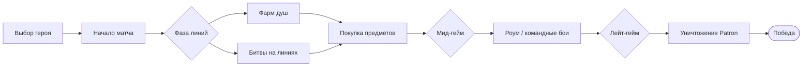
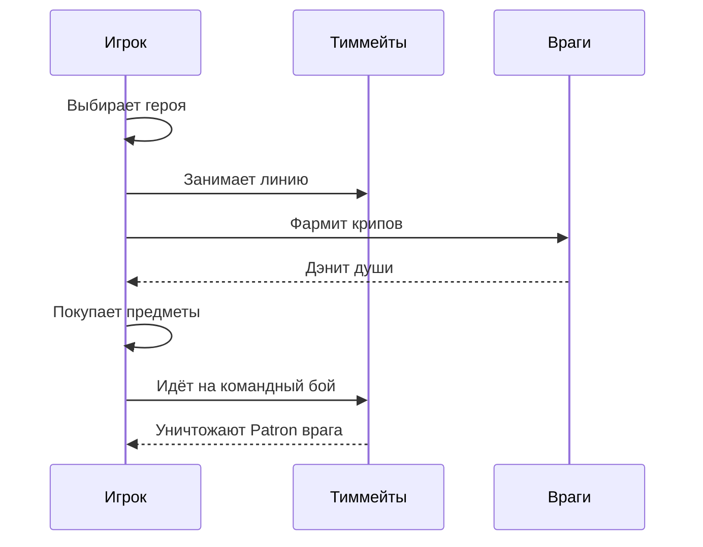

# 🎮 Deadlock Guide

<p align="center"><i>Обзор игрового процесса и механик командного шутера Valve</i></p>

---

## 📌 Навигация по проекту

**Разделы этого документа:**

- [О проекте](#-о-проекте)
- [Что такое Deadlock](#-что-такое-deadlock)
- [Игровой процесс](#-игровой-процесс)
- [Архитектура матча](#-архитектура-матча)
- [Сравнение режимов](#-сравнение-режимов)
- [Пример героя](#-пример-героя)
- [Документы проекта](#-документы-проекта)
- [Дорожная карта](#-дорожная-карта)
- [FAQ и цитаты](#-faq-и-цитаты)

**Файлы и папки репозитория:**

- 📁 [`src/`](src/) — демонстрационные примеры на Java
- 📚 [`resources/`](resources/) — документация и изображения

**Полезные внешние ссылки:**

- [Deadlock Wiki](https://deadlock.wiki/) — вики по игре
- [Steam страница Deadlock](https://store.steampowered.com/app/1422450/Deadlock/) — официальная страница
- [playdeadlock.com](https://playdeadlock.com/) — официальный сайт

---

## 📖 Оглавление

Быстрые ссылки-якоря по разделам документа:

1. [О проекте](#-о-проекте)
2. [Что такое Deadlock](#-что-такое-deadlock)
3. [Игровой процесс](#-игровой-процесс)
4. [Архитектура матча](#-архитектура-матча)
5. [Сравнение режимов](#-сравнение-режимов)
6. [Пример героя](#-пример-героя)
7. [Документы проекта](#-документы-проекта)
8. [Дорожная карта](#-дорожная-карта)
9. [FAQ и цитаты](#-faq-и-цитаты)

---

## 🧩 О проекте

**Deadlock Guide** — это *учебный* проект, который объясняет, как устроен игровой процесс Deadlock — командного шутера от Valve, находящегося в закрытом тестировании. Мы разбираем ключевые механики: от системы душ и трёх линий до уникальных способностей героев — и показываем это на простых диаграммах и псевдокоде.

> 💡 Все примеры в проекте — концептуальные учебные материалы

---

## 🎮 Что такое Deadlock?

Deadlock — это **third-person shooter MOBA** от Valve Corporation, впервые публично анонсированный в августе 2024 года . Игра сочетает стрельбу от третьего лица с механиками MOBA: три линии, крипы, прокачка героев и покупка предметов за души .

Действие происходит в альтернативном Нью-Йорке начала XX века под названием **The Cursed Apple**, где две фракции сражаются за призыв своего Покровителя (Patron) — бога, исполняющего желания . На данный момент игра находится в закрытой бете: доступ возможен только по приглашению от друга в Steam .

### Основные характеристики

- **Разработчик:** Valve Corporation
- **Жанр:** Third-person shooter, MOBA
- **Движок:** Source 2
- **Платформа:** Windows (Linux через Proton)
- **Статус:** Закрытая бета, дата релиза не объявлена 

---

## 🏗 Архитектура матча

<p align="center">
  
</p>



Дополнительно — последовательность действий игрока в типичном матче:



Подробнее — в документе [match-architecture.md](resources/docs/match-architecture.md).

---

## ⚖️ Сравнение режимов

<p align="center">
  
</p>

Кратко о доступных режимах:

- **Standard (6v6)** — классический режим с тремя линиями и фармом душ
- **Ranked** — соревновательный режим для опытных игроков
- **Street Brawl (4v4)** — roguelike-режим с короткими раундами и случайными предметами 

Полная таблица сравнения — в документе [modes-comparison.md](resources/docs/modes-comparison.md).

---

## 💻 Пример героя

Фрагмент из [`src/HeroAbility.java`](src/HeroAbility.java) — концептуальная модель способности героя:

```java
public class HeroAbility {
    private String name;
    private int cooldown;
    private int spiritScaling;

    public AbilityResult activate(Hero caster, GameState state) {
        if (!isReady()) {
            return AbilityResult.onCooldown(remainingCooldown());
        }
        if (caster.getSpiritPower() < spiritCost) {
            return AbilityResult.insufficientResource();
        }
        execute(caster, state);
        startCooldown();
        return AbilityResult.success(name);
    }

    private void execute(Hero caster, GameState state) {
        int damage = baseDamage + (caster.getSpiritPower() * spiritScaling / 100);
        state.getEnemiesInRange(caster.getPosition(), radius)
             .forEach(enemy -> enemy.takeDamage(damage));
    }
}
```

---

## 📂 Документы проекта

Все документы, созданные в рамках проекта:

1. [`src/HeroAbility.java`](src/HeroAbility.java) — модель способности героя
2. [`resources/docs/match-architecture.md`](resources/docs/match-architecture.md) — подробности структуры матча
3. [`resources/docs/modes-comparison.md`](resources/docs/modes-comparison.md) — сравнение режимов
4. [`resources/docs/faq.md`](resources/docs/faq.md) — часто задаваемые вопросы

---

## 🗺 Дорожная карта

- [x] Составить структуру проекта
- [x] Написать основной README.md
- [x] Добавить диаграммы Mermaid
- [x] Оформить навигацию и оглавление
- [ ] Дополнить раздел с примерами кода
- [ ] Добавить схему карты
- [ ] Провести финальную вычитку документации

---

## ❓ FAQ и цитаты

> «Deadlock — это третье лицо, MOBA и хаос, который работает» — из учебных материалов

> «Глубина приходит позже. Она терпеливая» 

Ответы на частые вопросы — в документе [faq.md](resources/docs/faq.md). Среди них:
как получить доступ к игре, чем Deadlock отличается от Dota 2 и почему игра до сих пор
не вышла официально (Valve продолжает доработку основных систем) .

---

<p align="center">Сделано с ❤️ в рамках самостоятельной работы по Git и Markdown</p>